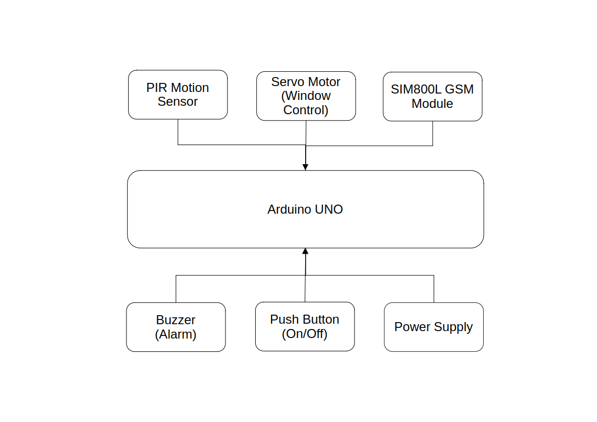
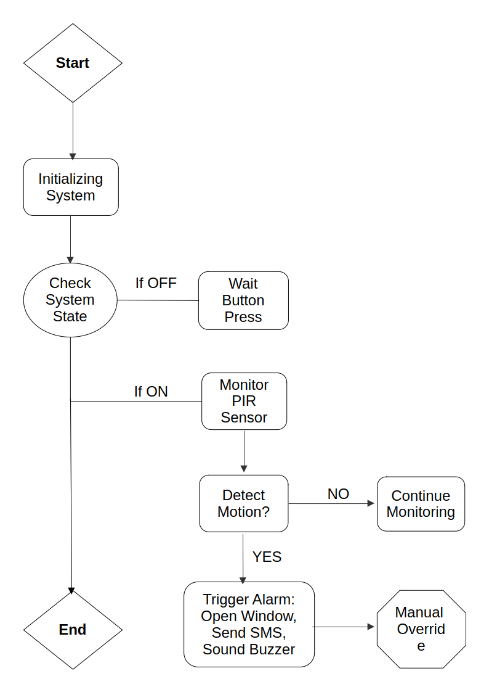
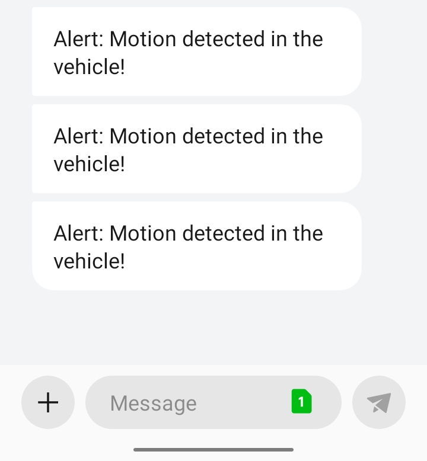
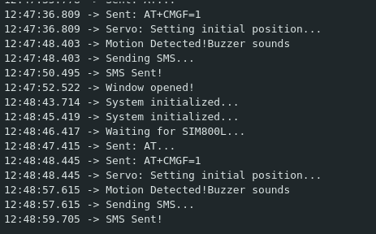
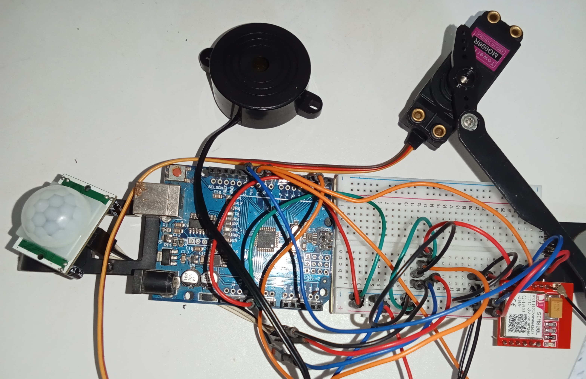

This post is the design-paper treatment of an Arduino based system that detects a person or pet left in a locked vehicle, sounds a buzzer, opens the window, and alerts the owner by SMS and voice call through a GSM module. A push button provides manual on/off control. The emphasis here is on the problem framing, requirements, system design and the engineering issues met during integration.

<!--more-->

## System design
 
The architecture is modular, with separate functional blocks connected through a single-chip microcontroller. A PIR motion sensor, a servo motor for window control and a SIM800L GSM module connect to an Arduino Uno on one side, and a buzzer, a push button and a power supply connect on the other.
 

*Fig. 1. System architecture.*
 
| Module | Part | Role |
|---|---|---|
| Sensing | PIR motion sensor (HC-SR501) | Detects movement inside the vehicle. |
| Control | Arduino Uno | Processes sensor data and controls actuators. |
| Actuation | Servo motor (MG996R) | Opens and closes the car window. |
| Communication | SIM800L GSM module | Sends SMS and makes voice calls to the owner. |
| Power | 9 V battery | Supplies the Uno, which regulates it through its onboard regulator. |

### Logic
 
At start-up the system initializes the PIR sensor, servo, GSM module, buzzer and push button, and the servo drives the window to the closed position. It then checks whether the system is active, which the push button controls. If it is off, it waits for a button press to turn it on. If it is on, it monitors the PIR output continuously, and on detecting motion it sounds the buzzer to alert people nearby, opens the window with the servo for ventilation, and sends an SMS and places a voice call to the owner. The button can toggle the system on or off at any time.
 

*Fig. 2. System logic flow.*

## Implementation
 
### Hardware
 
The PIR sensor connects to a digital input pin of the Arduino, and the servo connects to a PWM pin. The SIM800L connects to the Arduino's serial pins, the buzzer to a digital output pin, and the push button to a digital pin with a pull-up resistor so that an unpressed button reads HIGH and a press pulls the line LOW.
 
### Software
 
The firmware implements four behaviors. Motion detection reads the PIR output. Window control drives the servo open when a person is detected. Alerts use the GSM module to send an SMS and place a voice call to the owner. Manual override toggles the system on and off from the push button. In algorithm form: initialize the system and components, monitor the PIR continuously, and on movement sound the buzzer, open the window through the servo and send the SMS and voice call, while a button press at any point toggles the system state.
 
## Challenges and solutions
 
### Power supply stability
 
The system needs a stable 5 V rail, but a car's nominal 12 V battery supply fluctuates, especially around engine start and with other loads on the circuit. The paper's solution is either an external 5 V supply or a 5 V voltage regulator when drawing from the car battery, with capacitors added to smooth voltage spikes.
 
### Servo torque
 
A standard hobby servo may not have the torque to move a heavy car window. The paper uses a high-torque servo, the MG996R, together with a proper mechanical linkage to the window regulator.
 
### False alarms
 
A PIR sensor can be triggered by sunlight changes or moving objects outside the car, since it responds to changes in infrared level and not to what causes them. The paper's mitigation is to adjust the sensor's sensitivity and to add a confirmation delay before triggering, so a single transient does not fire the alarm.
 
### GSM connectivity
 
The SIM800L may fail to send alerts on poor network coverage. The paper proposes a retry mechanism in the code that resends the alert if the first attempt fails, plus a strong antenna signal.
 
### Mechanical integration
 
Mounting the servo and coupling it to the window mechanism is difficult in practice. The paper's answer is custom brackets and flexible couplings that attach the servo securely to the window mechanism.
 
## Results and discussion
 
The system was tested in a simulated car environment. The PIR sensor accurately detected the presence of a person, the servo opened and closed the window, and the GSM module sent SMS alerts and made voice calls as expected.
 

*Fig. 3. SMS alert sent to the car owner.*
 
The system responded within 2 to 3 seconds of detecting a person, operated consistently under the conditions tested, and drew minimal power, which suits in-vehicle use. The serial monitor capture in Fig. 4 backs up the timing: in the first logged trial, motion was detected at 12:47:48.403 and the SMS was confirmed at 12:47:50.495, about 2.1 s later, with the window-opened message at 12:47:52.522. A second trial after a reset shows motion at 12:48:57.615 and the SMS confirmed at 12:48:59.705, again about 2.1 s. The log shows the SMS path only, so the voice call is not independently confirmed by the capture.
 

*Fig. 4. Testing: serial monitor.*
 

*Fig. 5. The prototype: Arduino Uno, PIR sensor, buzzer, MG996R servo and SIM800L on a breadboard.*
 
### Limitations
 
The system relies on a PIR sensor with limited range and sensitivity, and because PIR detection is motion-based, a very still occupant such as a sleeping infant may not retrigger it. The servo needs calibration for different car models. The GSM module needs a stable network connection to deliver alerts, and the SIM800L is a 2G modem, which matters where 2G networks are being retired. Opening a window on an unattended vehicle is also a security trade-off, so limiting travel to a ventilation gap is worth considering.

